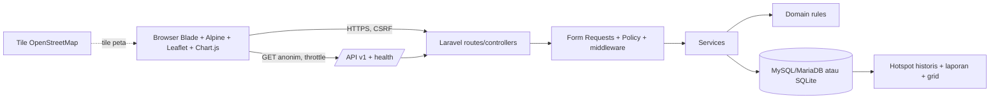

# Arsitektur

Laravel menjadi satu-satunya aplikasi server; tidak ada backend Node terpisah. Domain berisi formula murni, service mengorkestrasi query/transaksi, controller meneruskan input tervalidasi. API publik read-only menggunakan Resource dan mengecilkan presisi koordinat.

Foto di-encode ulang lalu disimpan sebagai base64 di DB; tidak bergantung pada disk sementara. MySQL/MariaDB adalah target produksi, migrasi/query juga dites terhadap SQLite. Session dan cache menggunakan database agar beberapa instance web dapat berbagi state. Semua instance harus berbagi DB dan konfigurasi `APP_KEY`; aset build disajikan statis. Jalankan migrasi terkoordinasi, gunakan backup DB dan external monitoring sebelum skala produksi. Cache database tetap memerlukan tuning dan tidak menggantikan cache terdistribusi saat trafik tinggi.

Batasan: geolokasi verifikator opsional dan tidak ditegakkan; jarak dapat dipalsukan. Hotspot demo tidak nyata. Belum ada sensor otomatis, integrasi instansi, antrean async, atau prediksi.
