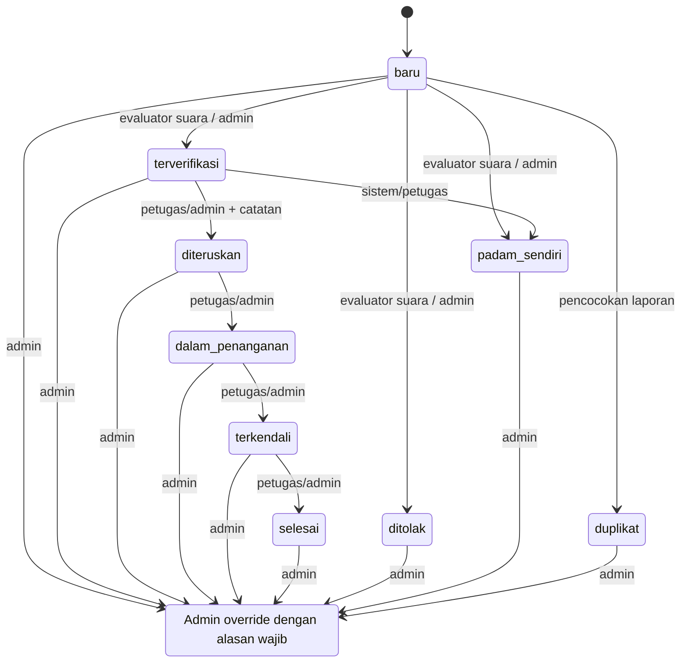

# State machine respons

Setiap perubahan status menyimpan `response_logs` dan notifikasi pelapor dalam transaksi DB yang sama. Transisi di luar daftar ditolak. Catatan wajib saat meneruskan laporan dan setiap override admin.
